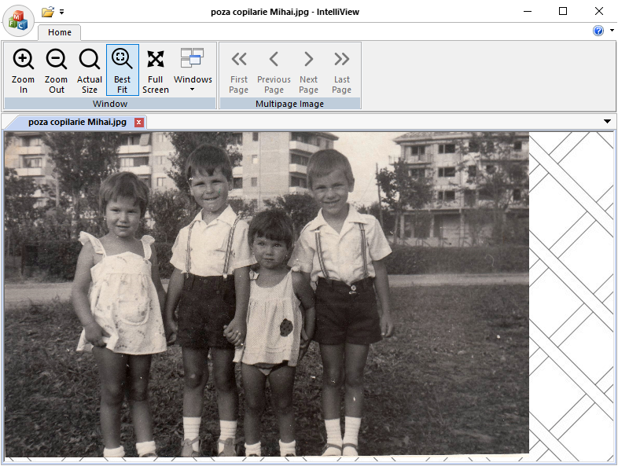

Download:
- [IntelliViewSetup.msi](https://www.moga.doctor/freeware/IntelliViewSetup.msi)
- [IntelliView.zip](https://www.moga.doctor/freeware/IntelliView.zip)

## Introduction

_IntelliView_ is a free (as in “free speech” and also as in “free beer”) Image Viewer. Running in the Microsoft Windows environment, its use is governed by [GNU General Public License v3.0](https://www.gnu.org/licenses/gpl-3.0.html). _IntelliView_ is written in C++ and uses pure Win32 API and STL which ensures a higher execution speed and smaller program size. By optimizing as many routines as possible without losing user friendliness, _IntelliView_ is trying to reduce the world carbon dioxide emissions. When using less CPU power, the PC can throttle down and reduce power consumption, resulting in a greener environment. I hope you enjoy _IntelliView_ as much as I enjoy coding it!

## Getting started

### Install IntelliView using the installer

- Download the installer
- Run the executable binary and follow the installation flow

The installer will likely require Administrative privileges in order to install _IntelliView_ (and later, to update _IntelliView_ or install or update plugins, or anything else that requires writing to the installation directory). If you do not have Administrative privileges, you either need to tell the installer to use a location where you do have write permission (though that may still ask for Administrator privileges), or you may choose not use the installer and instead run a portable edition from a directory where you have write permission.

### Install IntelliView from zip

These instructions will allow you to run a portable or mini-portable (also called “minimalist”), without requiring administrative privileges.

- Create a new folder somewhere that you have write-permission
- Unzip the content into the new folder
- Run _IntelliView_ from the new folder

The portable zip edition of _IntelliView_ can be removed by deleting the directory they came in. If you manually set up file associations or context-menu entries in the OS, it is your responsibility to remove them yourself.

## Application's menu

The _IntelliView_ menu features the application's most important functions:

- **Zoom In**: Increases Magnification.
- **Zoom Out**: Decreases Magnification.
- **Actual Size**: Shows the image at 100% magnification.
- **Best Fit**: Fits the image to the current window size.
- **Full Screen**: Shows the image in a full screen window.
- **First Page**: Views the first page in the current image.
- **Previous Page**: Views the previous page in the current image.
- **Next Page**: Views the next page in the current image.
- **Last Page**: Views the last page in the current image.
- **Open Page Number**: View a specific page in the current image.
- **Start/Stop Animation**: Starts or stops the animation for the current image.

## Roadmap

This roadmap outlines where _IntelliView_ is heading. It brings together the next steps for the features that are already there, ideas for new ones, and the maintenance work that goes into every release. Items are grouped by horizon rather than by date, and their order may change as feedback arrives or as the libraries _IntelliView_ builds on evolve, so please treat it as a statement of intent, not a promise. For everything that has already shipped, see the [Release Notes](https://github.com/mihaimoga/IntelliView/releases).

_Last reviewed: November 2026 (version 1.08 in development)._

### Now (in progress and ongoing)

- **Version 1.08**: session restore, which reopens the images that were open when _IntelliView_ was last closed, and a _Check for Updates_ dialog that stays open when no new version is found.
- **Up-to-date components**: releases keep picking up the latest Microsoft Edge WebView2 (embedded web browser) and genUp4win (automatic updates).
- **Stability, security and performance**: bug fixes, security updates and performance tuning continue alongside new features.

### Next (planned, next in line)

- **Browse the images in a folder**: move to the previous and next image in the same folder, instead of only between the pages of a multi-page image.
- **Slideshow**: step through the images of a folder automatically in full screen mode, at a configurable interval.
- **Options dialog**: one place to change settings that are fixed today, such as the slideshow interval, showing the file name in full screen mode and asking for confirmation before deleting a file.

Slideshow builds on browsing the images in a folder, and its interval is one of the settings the Options dialog is meant to expose, so these three items are likely to be tackled together.

### Later (planned, larger efforts)

- **Printing and print preview**: print the current image, scaled to fit the page, with a print preview.
- **Save As and format conversion**: save the current image in another format, using the Windows Imaging Component encoders and the built-in QOI writer.
- **Copy to the clipboard**: copy the current image so that it can be pasted into other applications.
- **Rotate and flip**: turn the image in 90-degree steps and mirror it, in addition to the automatic EXIF orientation that is applied today.

### Under consideration (ideas, not yet committed)

- **Mouse and keyboard navigation**: zoom with the mouse wheel, pan by dragging the image, and keyboard shortcuts for the commands that are only available through the ribbon and the context menu today.
- **Easier ways to open images**: drag & drop onto the window, and an installer option that registers _IntelliView_ as an image handler in Windows, so that file associations no longer have to be set up manually.
- **Image information**: show EXIF and other metadata inside _IntelliView_, in addition to the Windows Properties dialog that is used today.
- **Status bar and thumbnails**: a status bar showing the zoom level and the position in the folder (for example “3 of 24”), and an optional strip of thumbnails.
- **Localized user interface**: translated ribbon, commands and messages (today only the status messages of the updater are translated).
- **More image formats**: besides QOI, _IntelliView_ opens the formats that the Windows Imaging Component codecs installed on the PC can decode, so formats such as WebP, HEIC/AVIF or camera RAW depend on those codecs; built-in decoders could remove that dependency.
- **Native ARM64 and high-DPI support**: a native ARM64 build for Windows on Arm devices (_IntelliView_ is currently built for x86 and x64) and Per-Monitor V2 DPI awareness for a sharper interface on high-DPI and mixed-DPI displays.

### Help shape the roadmap

Want to see something sooner, or have an idea that is not listed here? [Open an issue](https://github.com/mihaimoga/IntelliView/issues) or start a conversation in [Discussions](https://github.com/mihaimoga/IntelliView/discussions). Contributions are welcome as well: any item above can be picked up through a pull request, as described in the next section.

## Create and Submit your Pull Request

As noted in the [Contributing Rules](https://github.com/mihaimoga/IntelliView/blob/main/CONTRIBUTING.md) for _IntelliView_, all Pull Requests need to be attached to a issue on GitHub. So the first step is to create an issue which requests that the functionality be improved (if it was already there) or added (if it was not yet there); in your issue, be sure to explain that you have the functionality definition ready, and will be submitting a Pull Request. The second step is to use the GitHub interface to create the Pull Request from your fork into the main repository. The final step is to wait for and respond to feedback from the developers as needed, until such time as your PR is accepted or rejected.

## Acknowledges

This open source project uses the following libraries:

- Stefan-Mihai MOGA's [genUp4win](https://github.com/mihaimoga/genUp4win)
- PJ Naughter's [EZView](https://www.naughter.com/ezview.html)
- PJ Naughter's [CHLinkCtrl](https://www.naughter.com/hlinkctrl.html)
- PJ Naughter's [CInstanceChecker](https://www.naughter.com/sinstance.html)
- PJ Naughter's [CVersionInfo](https://www.naughter.com/versioninfo.html)
